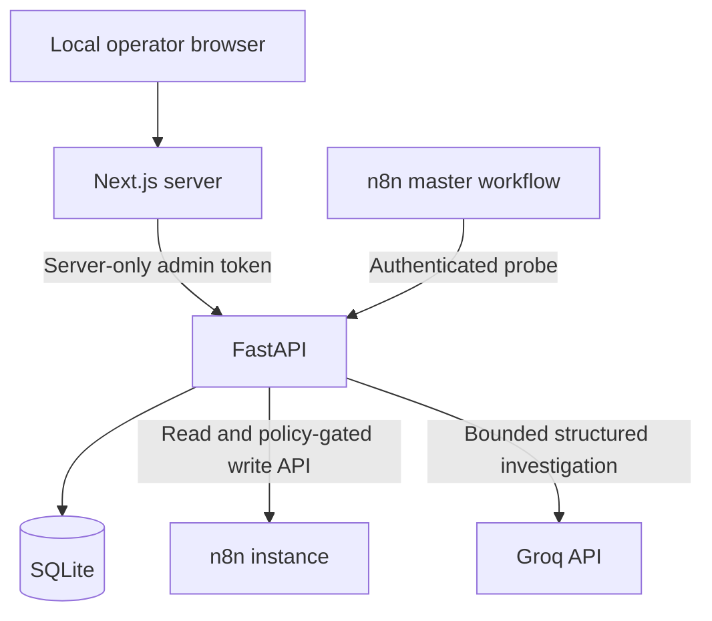
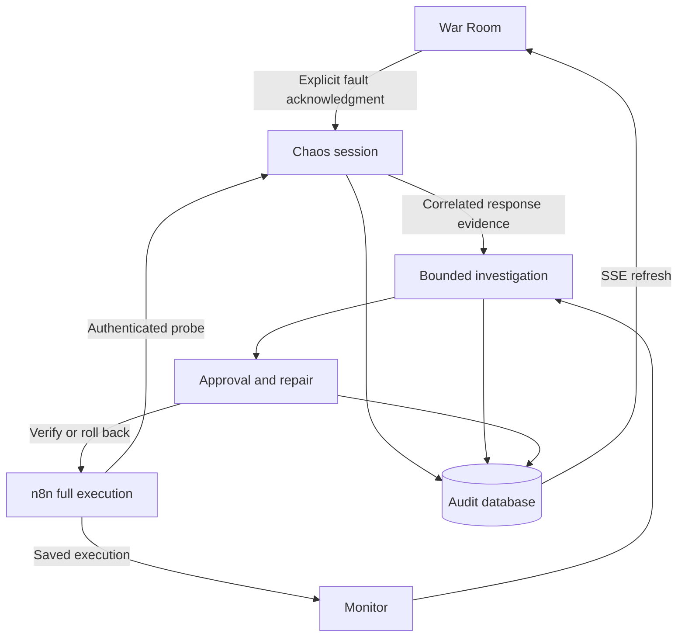

# Architecture and boundaries

## Current foundation and monitoring

The browser never receives either backend token. Next.js has no arbitrary proxy endpoint;
only fixed provider, monitoring, investigation and repair actions exist. Both processes must bind to loopback. The console supports an optional single-operator Basic authentication gate and validates Host.
Local OS access remains the default on loopback; non-loopback origins require HTTPS and credentials.
Public multi-user deployment is outside the verified release scope.
The API already requires scoped credentials for non-health endpoints.

The n8n master workflow now has one functional branch: manual trigger → authenticated local
Chaos probe. Named sticky-note sections describe the Python-controlled lifecycle without fake
pass-through stages. Full executions remain operator-run; no workflow is auto-published.

## Lifecycle plan (implementation status below)

The complete bounded pipeline will progress through Monitor, Triage, Diagnosis, Fix, Validator,
Risk, Approval, Executor and Verification. A persisted event must be committed before
its stage is displayed as active. Deterministic policy sits outside the model. No confidence
percentage will appear until its calculation and real evidence are available.

Phase 2 adds monitored workflows, execution cursors, incidents and persisted events.
Phase 3 adds typed agent runs and validated proposals. Phase 4 adds snapshots, approval
revision binding, minimal allowlisted patches, optimistic concurrency, verification and
rollback. Phase 5 adds designated chaos targets and visual event playback. Phase 6 closes
production deployment and security gates. Exactly six major phases are retained.

## Storage and compute

SQLAlchemy models and Alembic migrations avoid SQLite-specific data types. PostgreSQL
migration will require an installed psycopg driver and a changed database URL, followed
by data migration and concurrency verification; portability is not a claim of testing.
SQLite foreign keys, busy timeout and WAL are enabled. No operational seed data exists.

Use one API worker. Run a production Next.js build after installation to reduce steady-state
RAM. A development build can consume more memory; avoid running build and n8n simultaneously
on a 4 GB laptop. Actual peak RAM on that laptop still needs measurement. External Groq
inference avoids local model memory. Phase 2 now adds one read-only polling worker and persisted SSE events; see MONITORING.md.

## Health semantics

`alive` means the process responds. `ready` means the expected migrated schema is usable.
Configured credentials are not a successful connection. A successful Groq models request
is not proof of inference. An accepted heartbeat proves only authenticated delivery to
the database; its caller-provided workflow IDs are not independently verified against n8n
in Phase 1. It is never shown as workflow health, an execution result, or a healed incident.

## Phase 2 implementation

Read [MONITORING.md](MONITORING.md) for current detection, storage, privacy and event semantics.
Subsequent implementation details are recorded below.

## Phase 3 implementation update

The previously planned typed investigation stages are implemented; see [INVESTIGATION.md](INVESTIGATION.md).
New tables `investigations` and `agent_runs` preserve evidence, stage outputs and policy decisions.
The monitoring worker and investigation worker are separate bounded tasks in one API process.
Phase 4 now implements repairs and approval below. Chaos Mode is implemented in Phase 5 as described below.

## Phase 4 implementation

`app/repairs` separates approval preparation, minimal patch construction, encrypted snapshots,
execution verification and the durable worker. `repairs` stores immutable encrypted originals,
approval digests, before/after hashes, mutation intents and outcomes. `repair_safety` stores a
runtime pause latch. One async repair worker uses one application-level mutation lock and a
unique database claim per workflow. Run exactly one API worker.

The n8n public update API in tested 2.15.1 uses force-save and has no usable atomic compare-and-swap
precondition in its public schema. Therefore Phase 4 requires unpublished inactive workflows,
explicit allowlisting and exclusive operator maintenance. Pre/post read checks detect drift;
they cannot make an external editor participate in an atomic lock. Do not use it with concurrent
workflow editors. Published workflows and automatic workflow execution are deliberately blocked.

See [REPAIRS.md](REPAIRS.md) for exact state, verification, rollback and restart semantics.

## War Room and Chaos implementation

The War Room reads SQL aggregates and bounded event/history lists; existing SSE refreshes those
records. There is no artificial animation scheduler or seed data. `/operations` retains monitoring
and connection controls; incident details retain structured interpretation, evidence and approval.

`app/chaos` owns opt-in target designation, a healthy baseline gate, expiring sessions and
authenticated local probe responses. It does not call the n8n write API or fabricate executions.
The single n8n master template sends a GET to the local probe; the operator runs full executions.
Normal monitoring creates the incident, then the investigator correlates actual trace evidence
with response records. One automatic analysis can be queued per experiment. Triage escalation
and independent validator/risk decisions remain effective.

The repair lock prevents changing fault modes during active remediation. Approval rejects stopped
or expired source experiments. Expiry produces an error rather than silently creating a healthy
response. The existing repair worker performs all approved workflow writes and conditional rollback.

No additional runtime service is required. Run a single API worker, as in Phase 4.

## Release hardening

A file-backed SQLite OS lock encloses the API lifespan. Multiple API workers fail startup rather
than sharing in-memory repair locks. HTTP bodies are bounded before parsing, total requests and
concurrent SSE streams are limited, and the console validates hosts across all routes. Optional
single-operator authentication applies before rendering or proxying API requests. Next.js compression
remains disabled to avoid the observed Gzip listener warning. No EventEmitter warning is hidden.

The War Room filters routine polling only in its bounded event presentation. SQL aggregates still
use actual rows and all poll audit records remain persisted. Backups use SQLite backup plus integrity
checks; the matching snapshot key must be retained separately. See DEPLOYMENT.md for restart,
restore, secret rotation limits and the deliberately single-host operating model.
