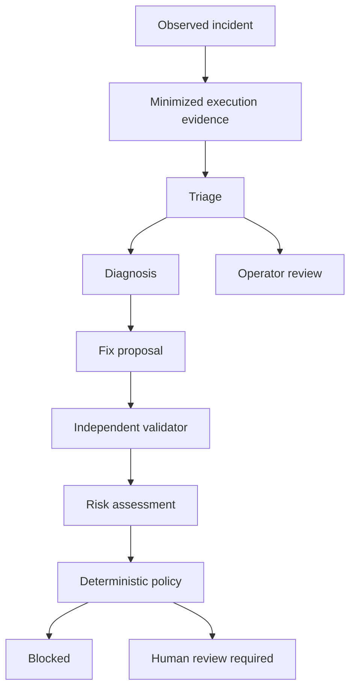

# Bounded AI investigation

One lightweight asynchronous worker runs beside read-only monitoring. SQLite records queued
investigations and each stage before any provider call. SSE streams the same persisted audit
records; the console highlights a stage only when its stored status is running.

## Data flow

Investigation itself is read-only. Human review required is a policy decision, not approval.
The separate Phase 4 repair service revalidates it before snapshot preparation and approval;
see REPAIRS.md. No proposal can directly call the writer.

## Evidence and privacy

The collector reads the exact saved execution and current workflow through n8n's public GET
API. IDs must match. Missing/pruned traces cause an explicit failure. Evidence includes:

- Actual detector category and allowlisted numeric/error-type facts.
- Node aliases, known node types, actual execution/error flags and output item counts.
- Allowlisted retry configuration and HTTP method, with documented n8n defaults.
- Aliased connections and up to five actual related incident categories/counts.
- Canonical configuration hashes for the saved execution and current workflow.

No credential fields, URLs, headers, input/output values, node names, code, raw error strings
or stack traces are sent to inference. They are excluded, not merely regex-redacted.
Known application secrets and common token/URL strings are additionally scrubbed from
provider input/output. Fingerprints cover full configuration in memory; original workflows
are not stored by investigation and these hashes are NOT restorable snapshots. Phase 4 stores
a separately encrypted original when an eligible repair review is prepared.

n8n 2.15.1 inserts default HTTP/manual-trigger parameters into execution snapshots. Hashing
normalizes only exact known defaults for those types; unknown differences conservatively
block proposals. Limits: 8 MiB per n8n response, 200 nodes, 500 connections, 100 KB serialized
AI evidence and 256 KB provider response. Large or unsupported evidence fails explicitly.
The omission of payloads/endpoints limits diagnosis; missing evidence must remain visible.

## Typed stages

Each stage uses a separate Groq request, with no tools or unbounded conversational loop.
Triage can stop with a persisted operator-review result. All other stages run in order; only HTTP 429 permits a bounded retry of the current stage.
The validator sees original facts plus prior outputs and can reject the fix. All outputs
must pass strict Pydantic schemas, bounded lengths, no extra fields, reference validation
and semantic checks. Unknown evidence/node/hypothesis references fail closed.

JSON object mode supports the user's existing configured model; it is NOT a provider-side
schema guarantee. Pydantic is the mandatory boundary. Truncation, provider errors and invalid
JSON/schema fail the run, with no automatic output repair. HTTP 429 alone permits one retry
per stage, at most three extra calls per investigation (eight total). Waits use provider timing
headers with a one-second margin, or 60 seconds when no usable hint exists. At most 120 seconds
per wait and 180 seconds total waiting are allowed; longer cooldowns fail explicitly.
Completed stages remain saved and are not rerun during these retries. Waiting/retrying events
are persisted and waits are asynchronous and cancellable. Each call has a 60-second timeout;
the investigation has a twelve-minute overall limit. No local model is required.

Sticky notes are omitted from inference facts. Each stage receives only relevant previous
outputs; the validator still receives original facts, diagnosis and fix. Compact JSON reduces
input overhead without removing schema validation. Provider error bodies are never retained.

## Proposal scope and deterministic policy

The only structured proposal fields in this release are `retryOnFail=true`, `maxTries=2..5`,
`waitBetweenTries=1000..5000`, on one HTTP GET/HEAD/OPTIONS node with an observed error.
Only timeout or HTTP 408/429/500/502/503/504 can justify this action class. Even these methods
may have external effects, so every allowed proposal requires human review, risk floor medium.
No-op/duplicate/multi-node patches, non-idempotent methods, stale configuration, unsupported
failure types, validator rejection, no supported hypotheses or a model risk block are denied.
URL/mapping/code/credential/output rewrites are outside this deliberately narrow allowlist.
A 404 cannot be fixed by inventing an endpoint. `no_safe_fix` is a legitimate outcome.

The UI shows before/after values for real proposals, including ones policy rejected. These
are static proposals, not JSON patches ready for execution; no replay has occurred.

## Confidence semantics

No LLM-assigned probability is requested. Evidence coverage is calculated as
`100 × distinct validator-supported hypothesis indices / actual hypothesis count`.
The numerator and denominator are visible. This is an auditable review measure, not calibrated
confidence or proof of a root cause. The label is Evidence-limited hypothesis or Reviewed
hypothesis depending on policy. AI interpretation remains separate from observed facts.

## Lifecycle and limits

One active investigation per incident is enforced by a unique nullable database claim.
Duplicate clicks return the active run. Maximum five active/queued runs and 20 new runs per
rolling 24 hours by default; failed/manual/automatic attempts all count. One API process is
required. API/operator actions are authenticated; console writes enforce trusted origin.
Models never decide queue budgets or security permissions.

New incidents created during this process lifetime are auto-investigated only when the
workflow is monitored, analysis is enabled and Groq is configured. No hidden backfill of
historical inference; request those manually. Failed runs are not retried automatically.
Restarted/incomplete provider calls become interrupted, not successful. Queued runs resume
with the actually configured model recorded when they start. Database interruption recovery
marks abandoned running jobs interrupted between jobs. Reanalysis creates a new immutable
run; the last ten are shown and earlier records stay in the database.

Investigation outcomes are escalated or review_required, never HEALED; only the separate
repair verifier can claim recovery. A later execution
success does not resolve the incident. Analysis references its captured execution even if
a newer failure arrives, and the UI warns about that difference.

## Provider documentation

- https://console.groq.com/docs/structured-outputs (JSON mode vs schema enforcement)
- https://console.groq.com/docs/api-reference (chat completions)

- https://console.groq.com/docs/rate-limits (429 and retry timing headers)
