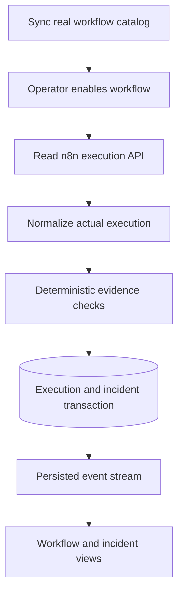

# Read-only monitoring semantics

## Pipeline

The n8n master remains the only importable workflow. Monitoring lives in Python to avoid
competing cursors/incident authorities. It does not depend on a schedule in n8n and does
not require changes to monitored workflows. Every workflow is paused after catalog sync
until explicitly enabled by the operator.

## Detection boundaries

| Signal | Required evidence |
| --- | --- |
| Failed execution | Actual n8n status error or crashed |
| Node exception | Error object in saved node or execution result |
| HTTP failure | HTTP error code, or HTTP Request full-response statusCode 400–599 |
| Timeout | Explicit timeout signal in actual error fields, including n8n messages array |
| Invalid JSON/parser failure | Explicit parser error or operator-defined JSON output contract |
| Empty required output | Enabled requirement and recorded empty output from the exact executed node |
| Abnormal latency | At least 20 prior successful same-workflow, same-mode executions |
| Repeated failure | A distinct execution with an existing normalized failure signature |

Latency uses up to 50 earlier successful runs without findings. Threshold is
max(3×median, median + max(1000 ms, 6×median absolute deviation)). Only an actual duration
above that threshold becomes a medium severity observation. Sample count, measured duration
and threshold are recorded. No model confidence score exists. Execution/node failures are
classified high severity by deterministic policy, not by AI business-impact inference.

Cancellation alone is not treated as timeout/failure. Waiting/running/new states are
revisited from persisted pending records. They cannot establish health. A skipped node
or missing trace cannot establish empty output. A body field named statusCode is not
assumed to be an HTTP status unless the recorded node is an HTTP Request configured for
full responses. JSON contract validation is syntax/type checking, not arbitrary schema
validation. Structured-output failure detection uses actual parser error signals only.

## Deduplication and lifecycle

Execution ID is unique within this single n8n-instance database. Each execution/incident
pair can occur once. Incident fingerprint includes workflow, node, failure category and
normalized error signature. Error normalization groups changing numeric values; it is a
practical grouping heuristic, not proof of a shared root cause. Incident status stays
DETECTED. A later successful execution cannot establish repair, cause, or resolution.
Root-cause reasoning and explicit incident resolution are later phases.

The execution, occurrence increment and timeline event commit in one database transaction.
Rescans and process restarts retain deduplication. Exactly one API worker owns the polling
loop. Multi-process deployment is unsupported until a database-backed worker lease exists.
A pause/config change is checked before evidence is committed. Workflows remain unmodified.

## Coverage and availability

Each cycle reads the newest page even while an older cursor is being processed. Catalog
sync commits only on complete retrieval, so partial/failing requests never silently delete
accessible workflow entries. Pending runs are revisited independent of head pagination.
A missing/oversized response is an evidence limitation, never a healthy result. n8n retention
settings bound coverage. No claim is made about executions n8n never retained.

Freshness labels are based on real last-check timestamps. A poll completes before its
monitor.polled event is emitted. The UI coalesces event-triggered refreshes and refreshes
freshness labels every 30 seconds. SSE replays by persisted event ID on reconnect. The
stream carries event metadata only; credentials stay in the Next.js server.

## Privacy and security

The monitor retains bounded IDs, safe labels, status, timestamps, durations, evidence
categories and minimal typed values (e.g. HTTP status). It does not persist arbitrary
input/output/error bodies, headers, stack traces, credentials or binary data. Known
configured secrets are removed from labels before truncation. Raw traces are held in
memory only during inspection. No Phase 2 evidence is sent to Groq.

Admin token: metadata sync, configuration, reads and manual check requests.
Ingest token: heartbeat only. Browser write routes enforce a configured same origin.
The local console still relies on loopback/OS access. Do not deploy it publicly yet.
Database and event retention automation, multi-instance monitoring, production login/RBAC,
AI diagnosis and repairs remain later release work.
