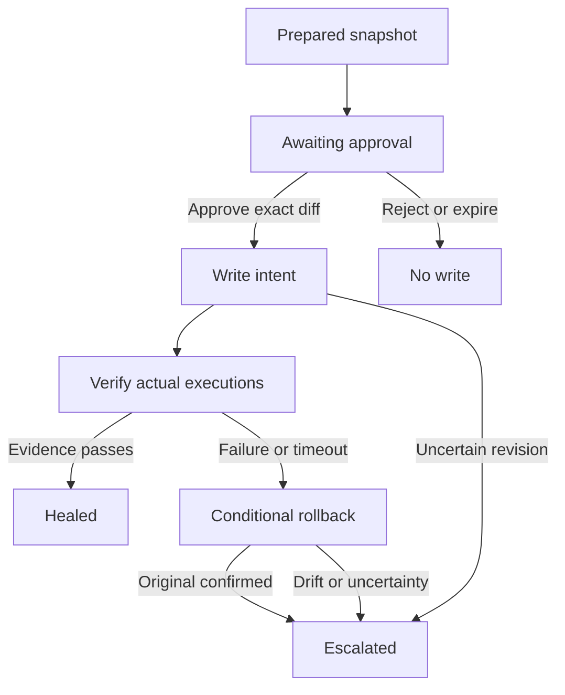

# Controlled remediation

Repairs are disabled by default. Every permitted action requires an explicit operator
approval; LLM risk output cannot override policy, the kill switch, or workflow designation.
Only bounded retry fields on one errored HTTP GET/HEAD/OPTIONS node are currently supported.
POST/404 incidents such as the accepted historical Incident #1 remain blocked.

## What is actually implemented

1. Reparse all five persisted stage schemas and evidence references. Recompute deterministic
   policy; require the latest completed eligible investigation and latest observed failure.
2. Fetch the current workflow. Require an explicitly designated, monitored, available,
   unpublished/inactive workflow, no pinned data, and matching investigation fingerprint.
3. Validate a small patch and preserve the original complete workflow encrypted with Fernet.
   Capture retry-only before/after values, original/expected hashes and a verification plan.
4. Persist an approval bound to that exact investigation, revision, diff and verification plan.
   It expires after 30 minutes. One workflow has one active repair claim. Reject performs no write.
5. On approval, require exclusive-maintenance acknowledgement (including conditional rollback).
   Repeat source/policy/current-revision checks. A separate worker checks again before applying.
6. Verify no in-flight executions in a bounded history scan. Commit a durable `applying` intent
   before PUT. Send only supported writable workflow fields, with unchanged settings/configuration
   except the approved retry fields. Never activate or publish. Read back from n8n to establish
   the outcome; do not infer success from an HTTP response.
7. Observe new actual executions of that exact patched configuration. The operator runs full
   executions in the n8n editor; no guessed public execute endpoint or automatic replay is used.
8. Require two successful executions, the affected node actually executed, complete unpinned
   evidence, no detector/output-contract failure, no inconclusive new execution, and at least
   60 seconds observation. Verification expires after 10 minutes. Claim HEALED only after a
   final current-configuration check. This is a bounded recovery observation, not proof that
   the patch caused recovery or a guarantee of future reliability.
9. Any observed patched failure or unmet deadline requests rollback. A zero-failure verification
   threshold is deliberately stricter than estimating an error-rate increase from a tiny sample.
   Roll back only when current state still matches the patched revision, no execution is in
   flight, and safety gates allow writes. Restore the original and verify read-back. The incident
   remains escalated after rollback. Missing/unsafe state escalates and retains the snapshot.

## State and audit

All important transitions enter `system_events`, streamed by the existing SSE endpoint.
Snapshots are encrypted database text, never returned to the browser or sent to inference.
Only the actual retry diff, hashes, timestamps and verification execution IDs are exposed.
Approval identity is the authenticated local operator, not a multi-user identity claim.

Worker operations have a 45-second time budget; incomplete evidence escalates, and a timed-out
mutation intent is reconciled before further action. History scans are bounded to 1,000 executions.

Restart with an `applying` intent performs read-back reconciliation without blindly resending
PUT. A persisted `rolling_back` intent similarly reconciles once. `verifying` resumes against
its original deadline. Ambiguous write results retain a workflow claim and require operator
recovery; the system does not clear uncertainty by fabricating success. The operator can use
Recheck recovery state: an observed original revision releases the claim; an observed patched
revision queues the previously authorized rollback; unknown revisions stay locked. A later monitored
failure reopens an incident previously marked healed.

## Kill switch and concurrency limits

`KILL_SWITCH=true` or the persisted runtime pause blocks every new mutation, including rollback.
The console cannot override the configured kill switch. The runtime latch is committed without
waiting for the repair worker lock; an HTTP write already in flight cannot be undone by pausing.
Release a runtime pause only after review. A blocked rollback stays pending when its configured
write gate is disabled; it is never silently discarded. Turning off the entire service also
stops verification, so leave it running during the observation window.

Run one API process/worker. Local async locking and a unique workflow claim prevent AgentSentinel
from running competing repairs. n8n 2.15.1's public update handler force-saves and does not offer a
usable public atomic revision precondition. Read-before/write/read-after is NOT atomic CAS.
Exclusive operator maintenance is mandatory. Do not edit or publish the workflow concurrently.
Active workflows are not automatically unpublished because that could interrupt production.

Unknown settings are never silently dropped to make an update pass. n8n 2.15.1 materializes
`callerPolicy=workflowsFromSameOwner` and `availableInMCP=false` on PUT; only these verified
exact default equivalents are canonicalized. Any non-default or unknown change remains visible
to revision checks. Other n8n versions require compatibility verification before writes.

## Replay safety and acceptance

There is no pre-apply execution replay because this release has no isolated side-effect sandbox.
Static structural/policy checks precede approval; actual post-apply full workflow runs are manually
initiated by the operator. HTTP read methods can still have side effects; inspect the entire
workflow and its external dependencies before approval. Do not describe static checks as tested
business behavior.

Local validation covers real n8n write/read-back/restore boundaries and real execution evidence.
A real Groq-generated eligible proposal through approval, worker application and full recovery
must still be tested on the user's configured dedicated workflow. Do not mark Phase 4 accepted
or start Phase 5 until that check and explicit user confirmation.
